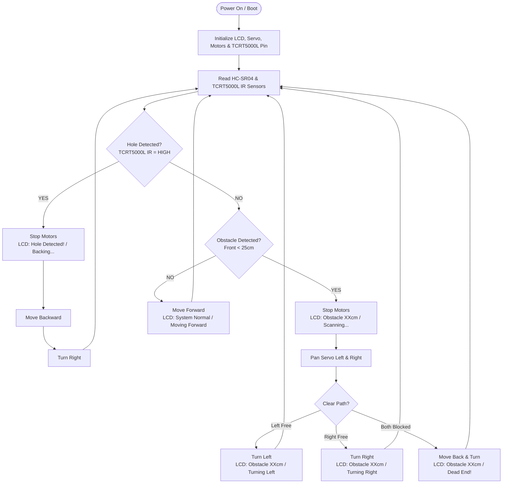

# ESP32 Autonomous Obstacle & Hole Avoidance Robot 🤖

An advanced, production-grade embedded C++ project for an autonomous dual-motor robot powered by the **ESP32 Dev Module**. The system features real-time obstacle detection using an **HC-SR04 Ultrasonic Sensor** mounted on an **SG90 Pan Servo**, downward drop-off/cliff detection via a **TCRT5000L Infrared (IR) Sensor**, PWM motor control using an **L298N driver**, and live system status updates on a **16x2 I2C LCD display**.

---

## 🌟 Key Features

- **Dual-Sensor Safety System**:
  - **Front Obstacle Avoidance**: HC-SR04 Ultrasonic sensor detects obstacles in front ($\le 25\text{ cm}$).
  - **Pan Scan Directional Decision**: SG90 Servo rotates $150^\circ$ (Left) and $30^\circ$ (Right) to select the clearer path.
  - **Hole & Drop-Off Detection**: Downward-pointing **TCRT5000L IR Sensor** detects cliffs/holes/stairs (loss of IR ground reflection) to trigger an immediate emergency stop, backup, and turn.
- **Motor Speed Control**: Pulse-Width Modulation (PWM) speed adjustment for L298N driver using native ESP32 `analogWrite`.
- **Status-Driven 16x2 I2C LCD**: Displays current system state (`System Normal / Moving Forward`, `Obstacle XXcm / Scanning`, `Hole Detected! / Backing...`).
- **Non-Blocking Logic**: Timer-based scheduling using `millis()` for LCD refresh and sensor loops.
- **High Efficiency & Fast Response**: Direct digital IR reading for instant cliff safety response.

---

## 📂 Directory Structure

```yaml
    ├── README.md                    # Project documentation & guide
    ├── obstacle.cpp                  # Clean C++ implementation source
    └── obstacle_avoiding_robot.ino  # Main Arduino sketch file
```

---

## 🛠️ Hardware Requirements & Components


| Component | Quantity | Description / Model |
| :--- | :---: | :--- |
| **Microcontroller** | 1 | ESP32 Dev Module (30-pin) |
| **Motor Driver** | 1 | L298N Dual H-Bridge Driver |
| **DC Motors** | 2 | 3V-6V TT DC Gear Motors with Wheels |
| **Ultrasonic Sensor** | 1 | HC-SR04 Ultrasonic Ranging Module |
| **IR Hole Sensor** | 1 | **TCRT5000L Infrared Reflective Sensor Module** |
| **Servo Motor** | 1 | SG90 Micro Servo (9g) |
| **Display** | 1 | 16x2 Character LCD with PCF8574 I2C Adapter |
| **Power Source** | 1 | 7.4V / 11.1V LiPo Battery + 5V Buck Regulator |

---

## 🔌 Hardware Wiring & Pin Mapping

### 1. ESP32 Pin Connections

```yaml
                     +-----------------------+
                     |    ESP32 Dev Module   |
                     +-----------------------+
                     | GPIO 14 ---> ENA      | (Motor A Speed - PWM)
                     | GPIO 27 ---> IN1      | (Motor A Dir 1)
                     | GPIO 26 ---> IN2      | (Motor A Dir 2)
                     | GPIO 25 ---> IN3      | (Motor B Dir 1)
                     | GPIO 33 ---> IN4      | (Motor B Dir 2)
                     | GPIO 32 ---> ENB      | (Motor B Speed - PWM)
                     |                       |
                     | GPIO 5  ---> TRIG     | (HC-SR04 Trigger)
                     | GPIO 18 ---> ECHO     | (HC-SR04 Echo)
                     |                       |
                     | GPIO 34 ---> OUT (DO) | (TCRT5000L IR Hole Sensor)
                     |                       |
                     | GPIO 19 ---> SERVO    | (SG90 Servo PWM Signal)
                     |                       |
                     | GPIO 21 ---> SDA      | (I2C SDA - 16x2 LCD)
                     | GPIO 22 ---> SCL      | (I2C SCL - 16x2 LCD)
                     +-----------------------+
```

### 2. Complete Wiring Table

| Module | Pin | ESP32 GPIO | Power / Connection |
| :--- | :--- | :--- | :--- |
| **L298N Driver** | `ENA` | GPIO 14 | Enable A (PWM Speed Motor A) |
| | `IN1` | GPIO 27 | Motor A Direction 1 |
| | `IN2` | GPIO 26 | Motor A Direction 2 |
| | `IN3` | GPIO 25 | Motor B Direction 1 |
| | `IN4` | GPIO 33 | Motor B Direction 2 |
| | `ENB` | GPIO 32 | Enable B (PWM Speed Motor B) |
| | `GND` | GND | Common System Ground |
| **HC-SR04** | `VCC` | 5V | 5V Power Supply |
| | `Trig` | GPIO 5 | Trigger Output |
| | `Echo` | GPIO 18 | Echo Input |
| | `GND` | GND | Common Ground |
| **TCRT5000L IR Sensor**| `VCC` | 3.3V / 5V | Sensor Power Supply |
| | `GND` | GND | Common Ground |
| | `OUT` / `DO`| GPIO 34 | Digital Signal Output |
| **SG90 Servo** | `Signal` | GPIO 19 | PWM Servo Signal Pin |
| | `VCC` | 5V | 5V Power Supply |
| | `GND` | GND | Common Ground |
| **16x2 LCD (I2C)** | `VCC` | 5V | 5V Power Supply |
| | `GND` | GND | Common Ground |
| | `SDA` | GPIO 21 | Hardware I2C SDA |
| | `SCL` | GPIO 22 | Hardware I2C SCL |

> [!IMPORTANT]
> The ESP32 operates at 3.3V logic level, but the HC-SR04, L298N driver logic supply, and I2C LCD are often powered by 5V. Ensure your power distribution supplies stable 5V to these components while sharing a unified **GND** connection.

---

## 🧠 Core System Logic & Timing

### Non-Blocking Executions
To ensure safety critical readings (like downward cliff/hole detection) are executed with minimal latency, this firmware avoids blocking `delay()` statements inside the main execution flow. 
Instead, it utilizes standard time-metering logic using the native `millis()` function. For example, LCD status updates are executed at defined periodic intervals without blocking the main sensor loop:
```cpp
if (millis() - lastLcdUpdateMs >= LCD_UPDATE_INTERVAL_MS) {
  lastLcdUpdateMs = millis();
  updateLCD("System Normal", "Moving Forward");
}
```

### Distance Calculations
The distance measurements from the HC-SR04 Ultrasonic sensor are calculated using the trigger pulse width duration in microseconds ($\mu s$):
$$Distance\ (cm) = \frac{Duration\ (\mu s) \times 0.0343}{2}$$

---

## ⚙️ How It Works (State Flow Diagram)



---

## 🖥️ LCD Status Modes

| Operational State | LCD Line 1 Display | LCD Line 2 Display | description |
| :--- | :--- | :--- | :--- |
| **Normal Driving** | `System Normal` | `Moving Forward` | Robot driving straight with no obstacles. |
| **Obstacle (Scanning)** | `Obstacle 18cm` | `Scanning...` | Stop active. Scanning left & right for free path. |
| **Turning Left** | `Obstacle 18cm` | `Turning Left` | Free path found on left. Executing left turn. |
| **Turning Right** | `Obstacle 18cm` | `Turning Right` | Free path found on right. Executing right turn. |
| **Dead End Action** | `Obstacle 18cm` | `Dead End!` | Both paths blocked. Backing up and spinning. |
| **Hole / Cliff Avoidance** | `Hole Detected!` | `Backing...` | Downward sensor output HIGH. Backing up immediately. |

---

## 🔧 TCRT5000L Sensor Calibration

1. Mount the TCRT5000L module facing straight down at the front of the robot chassis (~1-2 cm above the floor).
2. Adjust the blue potentiometer trimmer on the TCRT5000L module so that:
   - The **OUT LED turns ON (LOW signal)** when over flat floor/ground.
   - The **OUT LED turns OFF (HIGH signal)** when lifted above a drop-off edge or hole.

> [!WARNING]
> Proper calibration of the TCRT5000L sensor is extremely critical. If the potentiometer is miscalibrated, the robot may fail to detect cliffs, causing it to fall, or it may falsely report holes on uniform floors.

---

## 🚀 Installation & Flashing Instructions

1. **Open Arduino IDE** (v2.x recommended).
2. Install **ESP32 Board Support**:
   - Go to `File` $\rightarrow$ `Preferences`.
   - Go to `Tools` $\rightarrow$ `Board` $\rightarrow$ `Boards Manager...`, search for `esp32` by Espressif Systems and click **Install**.
3. Select Board: `ESP32 Dev Module` under `Tools` $\rightarrow$ `Board` $\rightarrow$ `esp32`.
4. Open [obstacle_avoiding_robot.ino](file:///c:/Users/ALIF/OneDrive/Desktop/anti/new/obstacle_avoiding_robot.ino).
5. Select Port: Choose your ESP32 COM Port under `Tools` $\rightarrow$ `Port`.
6. Click **Upload** (`Ctrl + U`).

---

## 🔍 Serial Monitor Telemetry

Open Serial Monitor (`Tools` $\rightarrow$ `Serial Monitor`) at **115200 baud** to monitor live sensor logs:

```text
==========================================
 ESP32 Robot OS Initializing... 
==========================================
[INIT] TCRT5000L IR Hole Sensor Initialized on GPIO 34.
[INIT] Initialization Complete. Starting main loop.

Obstacle Dist: 42.1 cm | TCRT5000L Hole IR: CLEAR (Ground OK)
Obstacle Dist: 18.2 cm | TCRT5000L Hole IR: CLEAR (Ground OK)
[AVOIDANCE] Obstacle detected at 18.2 cm! Stopping & scanning...
[SCAN] Left Distance: 45.0 cm
[SCAN] Right Distance: 12.0 cm
[ACTION] Free path on LEFT. Turning left.
```

---

## 🛠️ Troubleshooting & Common Issues

| Symptom | Probable Cause | Recommended Fix |
| :--- | :--- | :--- |
| **LCD is blank or shows blocks** | Incorrect contrast configuration or wrong I2C address | Adjust the contrast trimmer screw on the back of the I2C backpack. Run an I2C scanner script to confirm the LCD is at address `0x27`. |
| **Motors run in reverse** | Polarity mismatch on driver-to-motor wire connections | Reverse the wires on the terminal blocks for that motor, or reverse logic values in `moveForward`/`moveBackward`. |
| **Servo jitter or reset loop** | High current spikes drawn by motors/servo | Connect the servo to a separate 5V regulator. Ensure all ground pins (GND) are connected to a unified system ground. |
| **Ultrasonic reads constant -1** | Signal timing issue or faulty wiring | Verify TRIG/ECHO pins correspond to GPIO 5 and 18. Double check logic voltage; the sensor may require a full 5V supply to operate. |

---

## 📝 License

This project is released under the **MIT License**. Free for educational, hobbyist, and production embedded projects!

